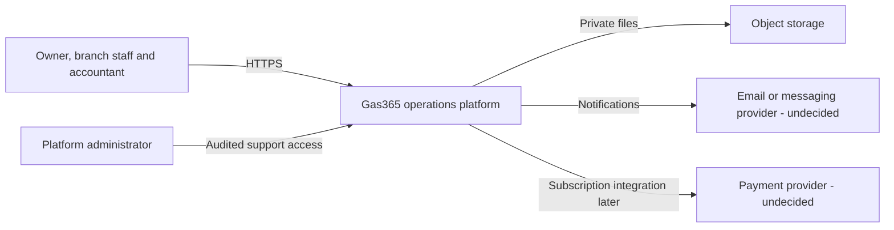
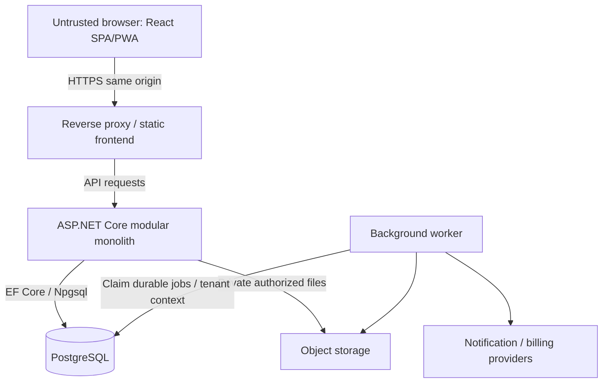

# Initial architecture

This is a target design, not a deployed system. Decisions are recorded in the [ADR index](adr/README.md).

## System context

## Containers and trust boundaries

Browser input is untrusted. The API validates membership, branch access, permissions and authoritative amounts. PostgreSQL owns transactional state. The worker uses the same application commands and tenant rules. Development uses separate Compose services; production separates the database from ephemeral application storage. Same-origin hosting supports the cookie decision in ADR 003.

## Module and dependency design

Domain contains business invariants and value objects without infrastructure dependencies. Application contains commands, queries, orchestration and ports. Infrastructure implements persistence, files and provider adapters. API composes dependencies and translates HTTP requests into application operations. React owns presentation and user interaction.

Modules: Identity, Tenancy, Branches, Catalog, Inventory, Purchasing, Sales, Customers, Suppliers, Credit, Cash, Expenses, Loans, Deliveries (scope pending), Reporting, Subscriptions, Audit and Notifications. Module ownership should be explicit; cross-module posting uses application orchestration inside one database transaction. No network calls belong inside the financial transaction; durable jobs record required follow-up work.

## Posting sequence

1. Authenticate, resolve membership and validate permission/branch.
2. Validate idempotency key and payload identity within the tenant and operation scope.
3. Load eligible draft and stock/payment state with concurrency protection.
4. Calculate decimal amounts and validate invariants on the server.
5. Atomically persist document snapshot, stock/cost effects, subledger/cash effects, audit and any durable job.
6. Commit and return a stable result. Retry returns that result; conflicting retries fail.

Exact locking strategy, decimal scales, document numbering and idempotency retention are decisions for their implementation phases. Do not infer them from spreadsheet formulas.

## Operational design

Use structured redacted logs, health endpoints, isolated environments, immutable image tags and a single controlled migration job. Backups must be restored in an isolated environment before launch. Deployment topology, recovery objectives and provider choices remain open. No scale claims are established by this documentation.
